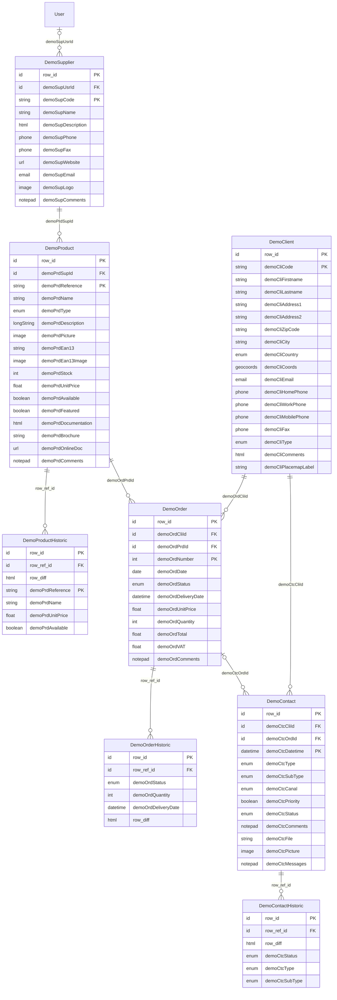

# User:designer

## General informations

**Name**:  Designer

**Preferred date format**: MM/DD/YYYY

**Preferred number format**: CD


# Module: Demo

**Packages**: DemoDashboard, DemoAPIs, DemoCustomDisp, DemoDSFR

This module contains demo **order management** application.

## Relationships



## Domains

Domains organize the application's main navigation menu. Each domain groups the objects, processes, and external pages accessible to users from it. Domains can be nested: a domain may have a parent domain.

```yaml
DemoDomain:
  parent: ~
  items:
    - name: DemoSupplier
      type: object
    - name: DemoProduct
      type: object
    - name: DemoClient
      type: object
    - name: DemoOrder
      type: object
    - name: DemoContact
      type: object
    - name: DemoDashboard
      type: external
    - name: DemoStats1
      type: object
    - name: DemoStats2
      type: object
    - name: DemoOrderCreate
      type: workflow
    - name: DemoPlaceNewOrder
      type: external
    - name: DemoOrderAgenda
      type: external
    - name: DemoCatalog
      type: external
    - name: RedoLog
      type: object
DemoSubDomain:
  parent: DemoDomain
```

## System parameters

```yaml
DEMO_PRD_LOWSTOCK_PERIOD: "90"
DEMO_PRD_LOWSTOCK_THRESHOLD: "10"
DEMO_VAT: "20.0"
MAP_SETTINGS: "{    \"tileLayer\":\"https://tile.openstreetmap.org/{z}/{x}/{y}.png\",    \"attribution\":\"&copy; <a href=\\"http://www.openstreetmap.org/copyright\\">OpenStreetMap</a>\",    \"maxZoom\":19 }"  # APP — Map settings (for the Customer map)
```

## DemoContact

```yaml
label: Contact
table: demo_contact
```

The **contact** object holds the interactions with the clients.

A contact can be linked or not a an order of the selelcted client
(when linked to an order the `demoCtcOrdId` field is set).

### Relationships

```yaml
belongs_to:
  - DemoClient (demoCtcCliId, required, on parent delete: cascade)  # contact customer
  - DemoOrder (demoCtcOrdId, optional, on parent delete: cascade)  # contact order
has_many:
  - DemoContactHistoric via row_ref_id [on delete: cascade, visible]
```

### Fields

```yaml
auto:
  demoCtcDatetime: datetime  # Contcat date and time [unique key] [col:ctc_datetime] [default:[DATETIME]]

required:
  demoCtcType: enum(10) using DEMO_CTC_TYPE list  # Contact type [col:ctc_type]
  demoCtcCanal: enum(10) using DEMO_CTC_CANAL list  # Canal used for contact [col:ctc_canal] [default:PHONE]
  demoCtcPriority: boolean  # Contact priority [col:ctc_priority] [default:0]
  demoCtcStatus: enum(1) using DEMO_CTC_STATUS list  # Contact status [col:ctc_status] [default:O]
  demoCtcMessages: notepad(2147483647)  # Messages [col:ctc_messages]

optional:
  demoCtcSubType: enum(10) using DEMO_CTC_SUBTYPE list  # Contact sub type [col:ctc_subtype]
  demoCtcComments: notepad(2147483647)  # Comments on contact [col:ctc_comments]
  demoCtcFile: document  # Contact attached file [col:ctc_file]
  demoCtcPicture: image  # [col:ctc_picture]

referenced:
  demoCliCode: regexp(10)  # Customer code [col:cli_code]
  demoCliFirstname: char(100)  # Customer first name [col:cli_firstname]
  demoCliLastname: char(100)  # Customer last name [col:cli_lastname]
  demoCliEmail: email(50)  # Customer email address [col:cli_email]
  demoCliHomePhone: phone(20)  # Customer home phone number [col:cli_homephone]
  demoCliWorkPhone: phone(20)  # Customer work phone number [col:cli_workphone]
  demoCliMobilePhone: phone(20)  # Customer mobile phone number [col:cli_mobilephone]
  demoCliFax: phone(20)  # Customer fax number [col:cli_fax]
  demoOrdNumber: int(11)  # Order number (automatically calculated at creation) [col:ord_number]
  demoOrdDate: date  # Order date [col:ord_date]
  demoOrdStatus: enum(30) using DEMO_ORD_STATUS list  # Order status [col:ord_status]
  demoOrdCliId: id  # Order customer [col:ord_cli_id]
  demoOrdPrdId: id  # Order product [col:ord_prd_id]
  demoPrdSupId: id  # Product supplier [col:prd_sup_id]
  demoSupUsrId: id  # User responsible of supplier [col:sup_usr_id]
  demoPrdReference: regexp(10)  # Product reference [col:prd_code]
  demoPrdName: char(100)  # Product name [col:prd_name]
  demoOrdQuantity: int(11)  # Product quantity ordered [col:ord_quantity]

```

### Enumerations

Codes detailed as `label` + a target field hold a linked list: selecting that code switches the target field to the nested list of values.

```yaml
DEMO_CTC_TYPE:
  INF:
    label: Information
    demoCtcSubType:  # DEMO_CTC_SUBTYPE_INF
      ORDSTATUS: Order status
      PRDINFO: Product information
  REQ:
    label: Request
    demoCtcSubType:  # DEMO_CTC_SUBTYPE_REQ
      ORDCANCEL: Order cancelation
      ORDCHANGE: Order change
  CMP:
    label: Complaint
    demoCtcSubType:  # DEMO_CTC_SUBTYPE_CMP
      ORDISSUE: Order issue
      BILLISSUE: Billing issue
  OTH:
    label: Other

DEMO_CTC_SUBTYPE:
  EMPTY: (empty)

DEMO_CTC_CANAL:
  PHONE: Code PHONE
  EMAIL: Code EMAIL
  CHAT: Code CHAT
  WEB: Code WEB

DEMO_CTC_STATUS:
  O: Open
  P: Processing
  C: Closed
```

### State transitions (demoCtcStatus)

```yaml
O: [P, C]
P: [O, C]
C: [O]
```

### Constraints

```yaml
DemoContact-C1:
  condition: true
  effects: back
  description: Fields not updatable by default
  impacts:
    - demoCtcStatus.updatable = false
    - demoCtcType.updatable = false
    - demoCtcSubType.updatable = false
    - demoCtcCanal.updatable = false
    - demoCtcCliId.updatable = false
    - demoCtcOrdId.updatable = false

DemoContact-C2:
  condition: ![ISNEW]
  effects: back
  description: Status field only updatable by the administrator
  impacts:
    - demoCtcStatus.updatable = true

DemoContact-C4:
  condition: true
  effects: back, front
  description: Show/hide sub-type depending on type
  impacts:
    - demoCtcSubType.visible = ![FIELD:demoCtcType].isEmpty() && [VALUE:demoCtcType] != "OTH"
    - demoCtcSubType.mandatory = ![FIELD:demoCtcType].isEmpty() && [VALUE:demoCtcType] != "OTH"

DemoContact-C3:
  condition: [ISNEW]
  effects: back
  description: Fields updatable at creation
  impacts:
    - demoCtcType.updatable = true
    - demoCtcSubType.updatable = true
    - demoCtcCanal.updatable = true
    - demoCtcCliId.updatable = true
    - demoCtcOrdId.updatable = true

DemoContact-C5:
  condition: true
  effects: front
  description: Allow order selection **after** customer selection
  impacts:
    - demoCtcOrdId.updatable = [ISNEW] && ![FIELD:demoCtcCliId].isEmpty()
```

### Description (from code)

Contact business object

### Hooks

```yaml
printMustache: HTML publication (using Mustache(R) templating) method
printExcel: Microsoft Excel(R) sheet publication method
postLoad: ~
canReference: ~
getUserKeyLabel: ~
```

---

## DemoContactHistoric

```yaml
label: Contact (hist.)
table: demo_contact_hist
```

**Contact** object history, tracks changes on:

- Status
- Type and/or subtype
- Comments

History of DemoContact.

### Relationships

```yaml
belongs_to:
  - DemoContact (row_ref_id, required, on parent delete: cascade)  # record row id
has_many: []
```

### Fields

```yaml
referenced:
  demoCtcDatetime: datetime  # Contcat date and time [col:ctc_datetime]
  demoCtcCliId: id  # Contact customer [col:ctc_cli_id]
  demoCliCode: regexp(10)  # Customer code [col:cli_code]

tracked:
  row_diff: html(2000000)  # Computed differences between a row and its previous sibling row of the same object.

To enable it:
- add the `row_diff` field to the object
- call `setRowDiff(true)` in `postLoad`

It is enabled by default on the history panel of the parent object.
  demoCtcStatus: enum(1) using DEMO_CTC_STATUS list  # Contact status [col:ctc_status] [default:O]
  demoCtcType: enum(10) using DEMO_CTC_TYPE list  # Contact type [col:ctc_type]
  demoCtcSubType: enum(10) using DEMO_CTC_SUBTYPE list  # Contact sub type [col:ctc_subtype]
```

### Enumerations

```yaml
DEMO_CTC_STATUS:
  O: Open
  P: Processing
  C: Closed

DEMO_CTC_TYPE:
  INF: Information
  REQ: Request
  CMP: Complaint
  OTH: Other

DEMO_CTC_SUBTYPE:
  EMPTY: (empty)
```

---

## DemoOrder

```yaml
label: Order
table: demo_order
```

The **order** business object corresponds to the
product orders placed by clients.

An order is for one single product.

### Relationships

```yaml
belongs_to:
  - DemoClient (demoOrdCliId, required, on parent delete: cascade)  # order customer
  - DemoProduct (demoOrdPrdId, required, on parent delete: cascade)  # order product
has_many:
  - DemoContact via demoCtcOrdId [on delete: cascade, visible]
  - DemoOrderHistoric via row_ref_id [on delete: cascade, visible]
```

### Fields

```yaml
auto:
  demoOrdNumber: int(11)  # Order number (automatically calculated at creation) [unique key] [col:ord_number] [default:[ROWID]]
  demoOrdDate: date  # Order date [col:ord_date] [default:[DATE]]
  demoOrdUnitPrice: float(11, 2)  # Product unit price for order [col:ord_unitprice]
  demoOrdTotal: float(11, 0)  # Total order amount [col:ord_total] [default:0]
  demoOrdVAT: float(11, 2)  # VAT for order [default:0]

required:
  demoOrdStatus: enum(30) using DEMO_ORD_STATUS list  # Order status [col:ord_status] [default:P]
  demoOrdQuantity: int(11)  # Product quantity ordered [col:ord_quantity] [default:1]

optional:
  demoOrdDeliveryDate: datetime  # Order delivery date [col:ord_deliverydate] [default:[DATE:3] + " 08:00:00"]
  demoOrdComments: notepad(2147483647)  # Comments on order [col:ord_comments]

referenced:
  demoCliCode: regexp(10)  # Customer code [col:cli_code]
  demoCliFirstname: char(100)  # Customer first name [col:cli_firstname]
  demoCliLastname: char(100)  # Customer last name [col:cli_lastname]
  demoCliEmail: email(50)  # Customer email address [col:cli_email]
  demoCliAddress1: char(100)  # Customer address (line 1) [col:cli_address1]
  demoCliAddress2: char(100)  # Customer address (line 2) [col:cli_address2]
  demoCliZipCode: char(10)  # Customer postal code [col:cli_zipcode]
  demoCliCity: char(50)  # Customer city [col:cli_city]
  demoCliCountry: enum(30) using DEMO_COUNTRY list  # Customer country [col:cli_country]
  demoPrdReference: regexp(10)  # Product reference [col:prd_code]
  demoPrdName: char(100)  # Product name [col:prd_name]
  demoPrdType: enum(50) using DEMO_PRD_TYPE list  # Product type [col:prd_type]
  demoPrdEan13: char(13)  # EAN13 code [col:prd_ean13]
  demoPrdSupId: id  # Product supplier [col:prd_sup_id]
  demoSupCode: regexp(50)  # Supplier unique code (e.g. `MYSUP`) [col:sup_code]
  demoSupName: char(100)  # Supplier name [col:sup_name]
  demoSupUsrId: id  # User responsible of supplier [col:sup_usr_id]
  demoPrdStock: int(11)  # Current stock for product [col:prd_stock]
  demoPrdUnitPrice: float(11, 0)  # Unit price of product [col:prd_unitprice]

```

### Enumerations

```yaml
DEMO_ORD_STATUS:
  P: Pending status
  H: On hold
  V: Validated status
  D: Shipped status
  C: Canceled status
```

### State transitions (demoOrdStatus)

```yaml
P: [V, H, C]
V: [P, H, D, C]
H: [P, V, C]
C: [P, V]
D: []  # terminal
```

### Constraints

```yaml
DemoOrder-C1:
  condition: true
  effects: back
  description: Fields not updatable by default
  impacts:
    - demoOrdStatus.updatable = false
    - demoOrdQuantity.updatable = false
    - demoOrdCliId.updatable = false
    - demoOrdPrdId.updatable = false
    - demoOrdDeliveryDate.visible = ObjectField.VIS_NOT
    - demoOrdDeliveryDate.updatable = false
    - demoOrdDeliveryDate.mandatory = false

DemoOrder-C2:
  condition: true
  effects: back
  description: Status field only updatable by the administrator
  impacts:
    - demoOrdStatus.updatable = true

DemoOrder-C3:
  condition: [ISNEW] || [STATUS] == "P"
  effects: back
  description: Customer, product and quantity fields updatable at creation or when the order  is still in pending state
  impacts:
    - demoOrdQuantity.updatable = true
    - demoOrdCliId.updatable = true
    - demoOrdPrdId.updatable = true

DemoOrder-C4:
  condition: ![ISNEW] && [STATUS] != "C"
  effects: back
  description: Delivery date field only updatable when the order is not delivered nor cancelled
  impacts:
    - demoOrdDeliveryDate.visible = ObjectField.VIS_FORM
    - demoOrdDeliveryDate.updatable = [STATUS] != "D" && [STATUS] != "C"

DemoOrder-C5:
  condition: [STATUS] == "V"
  effects: back
  description: Delivery order field mandatory at validation
  impacts:
    - demoOrdDeliveryDate.mandatory = true

DemoOrder-C6:
  condition: true
  effects: back
  description: Allow order deleteion only in pending state
  impacts:
    - object.delete = [STATUS] == "P"

DemoOrder-C7:
  condition: true
  effects: back
  description: Update order only if administrator or if responsible of the product's supplier
  impacts:
    - object.update = [VALUE:demoOrdPrdId.demoPrdSupId.demoSupUsrId] == [USERID]+""
    - object.delete = [VALUE:demoOrdPrdId.demoPrdSupId.demoSupUsrId] == [USERID]+""
```

### Description (from code)

Order business object

### Hooks

```yaml
postValidate: ~
postUpdate: ~
postSave: ~
canReference: ~
isPrintTemplateEnable: ~
getUserKeyLabel: ~
```

---

## DemoOrderHistoric

```yaml
label: Order (hist.)
table: demo_order_hist
```

**Order** object history, tracks changes on:

- Status
- Quantity

History of DemoOrder.

### Relationships

```yaml
belongs_to:
  - DemoOrder (row_ref_id, required, on parent delete: cascade)  # record row id
has_many: []
```

### Fields

```yaml
referenced:
  demoOrdNumber: int(11)  # Order number (automatically calculated at creation) [col:ord_number]
  demoOrdCliId: id  # Order customer [col:ord_cli_id]
  demoCliCode: regexp(10)  # Customer code [col:cli_code]
  demoOrdPrdId: id  # Order product [col:ord_prd_id]
  demoPrdReference: regexp(10)  # Product reference [col:prd_code]
  demoPrdSupId: id  # Product supplier [col:prd_sup_id]
  demoSupCode: regexp(50)  # Supplier unique code (e.g. `MYSUP`) [col:sup_code]

tracked:
  demoOrdStatus: enum(30) using DEMO_ORD_STATUS list  # Order status [col:ord_status] [default:P]
  demoOrdQuantity: int(11)  # Product quantity ordered [col:ord_quantity] [default:1]
  demoOrdDeliveryDate: datetime  # Order delivery date [col:ord_deliverydate] [default:[DATE:3] + " 08:00:00"]
  row_diff: html(2000000)  # Computed differences between a row and its previous sibling row of the same object.

To enable it:
- add the `row_diff` field to the object
- call `setRowDiff(true)` in `postLoad`

It is enabled by default on the history panel of the parent object.
```

### Enumerations

```yaml
DEMO_ORD_STATUS:
  P: Pending status
  H: On hold
  V: Validated status
  D: Shipped status
  C: Canceled status
```

---

## DemoProductHistoric

```yaml
label: Product (hist.)
table: demo_product_hist
```

**Product** object history, tracks changes on:

- Product name
- Unit price
- Availability

History of DemoProduct.

### Relationships

```yaml
belongs_to:
  - DemoProduct (row_ref_id, required, on parent delete: cascade)  # record row id
has_many: []
```

### Fields

```yaml
referenced:
  demoPrdSupId: id  # Product supplier [col:prd_sup_id]
  demoSupCode: regexp(50)  # Supplier unique code (e.g. `MYSUP`) [col:sup_code]
  demoPrdReference: regexp(10)  # Product reference [col:prd_code]

tracked:
  row_diff: html(2000000)  # Computed differences between a row and its previous sibling row of the same object.

To enable it:
- add the `row_diff` field to the object
- call `setRowDiff(true)` in `postLoad`

It is enabled by default on the history panel of the parent object.
  demoPrdReference: regexp(10)  # Product reference [unique key] [col:prd_code]
  demoPrdName: char(100)  # Product name [col:prd_name]
  demoPrdUnitPrice: float(11, 0)  # Unit price of product [col:prd_unitprice] [default:0]
  demoPrdAvailable: boolean  # Available product? [col:prd_available] [default:1]
```

---

## DemoSupplier

```yaml
label: Supplier
table: demo_supplier
```

The **supplier** business object corresponds to the
suppliers of products that can be ordered.

### Relationships

```yaml
belongs_to:
  - User (demoSupUsrId, optional)  # user responsible of supplier
has_many:
  - DemoProduct via demoPrdSupId [on delete: cascade, visible]
```

### Fields

```yaml
required:
  demoSupCode: regexp(50)  # Supplier unique code (e.g. `MYSUP`) [unique key] [col:sup_code]
  demoSupName: char(100)  # Supplier name [col:sup_name]

optional:
  demoSupDescription: html(1000000)  # Supplier description [col:sup_description]
  demoSupPhone: phone(20)  # Supplier phone number [col:sup_phone]
  demoSupFax: phone(20)  # Supplier fax number [col:sup_fax]
  demoSupWebsite: url(100)  # Supplier website URL [col:sup_website]
  demoSupEmail: email(20)  # Supplier email address [col:sup_email]
  demoSupLogo: image  # Supplier logo [col:sup_logo]
  demoSupComments: notepad(2147483647)  # Comments on supplier [col:sup_comments]

referenced:
  usr_login: regexp(100)  # Login [col:usr_login]

```

---

## DemoProduct

```yaml
label: Product
table: demo_product
```

The **product** business object corresponds to the
products that can be ordered.

Its reference is unique per supplier.

### Relationships

```yaml
belongs_to:
  - DemoSupplier (demoPrdSupId, required, on parent delete: cascade)  # product supplier
has_many:
  - DemoOrder via demoOrdPrdId [on delete: cascade, hidden]
  - DemoProductHistoric via row_ref_id [on delete: cascade, visible]
```

### Fields

```yaml
auto:
  demoPrdReference: regexp(10)  # Product reference [unique key] [col:prd_code]

required:
  demoPrdName: char(100)  # Product name [col:prd_name]
  demoPrdType: enum(50) using DEMO_PRD_TYPE list  # Product type [col:prd_type]
  demoPrdStock: int(11)  # Current stock for product [col:prd_stock] [default:0]
  demoPrdUnitPrice: float(11, 0)  # Unit price of product [col:prd_unitprice] [default:0]
  demoPrdAvailable: boolean  # Available product? [col:prd_available] [default:1]
  demoPrdFeatured: boolean  # Featured product? [col:prd_featured] [default:0]

optional:
  demoPrdDescription: text(1000000)  # Product description [col:prd_description]
  demoPrdPicture: image  # Product picture [col:prd_picture]
  demoPrdEan13: char(13)  # EAN13 code [col:prd_ean13]
  demoPrdEan13Image: image  # EAN13 code image [col:prd_ean13_image]
  demoPrdDocumentation: html(1000000)  # Product documentation [col:prd_documentation]
  demoPrdBrochure: document  # Product brochure [col:prd_brochure]
  demoPrdOnlineDoc: url(255)  # Online product documentation URL [col:prd_onlinedoc]
  demoPrdComments: notepad(2147483647)  # Comments on product [col:prd_comments]

referenced:
  demoSupCode: regexp(50)  # Supplier unique code (e.g. `MYSUP`) [col:sup_code]
  demoSupName: char(100)  # Supplier name [col:sup_name]
  demoSupUsrId: id  # User responsible of supplier [col:sup_usr_id]

```

### Enumerations

```yaml
DEMO_PRD_TYPE:
  LAPTOP: Laptop
  DESKTOP: Desktop
  TABLET: Tablet
  SMARTPHONE: Smartphone
  OTHER: Other
```

### Actions

```yaml
DEMO_INCSTOCK:
  description: Sample action for product stock **increment** (by `N` specified in the product business object code).
DEMO_DECSTOCK:
  description: Product stock **decrement** triggered by the order state transition to _shipped_ status.
DEMO_PRD_EMAIL:
  description: Send product information by email
```

### Description (from code)

Product business object

### Hooks

```yaml
increaseStock: Increase stock action method
decreaseStock: Decrease stock action method
printBrochure: Microsoft Word(R) brochure publication method
initAction: ~
preSave: ~
canReference: ~
getUserKeyLabel: ~
sendEmail: Send product data in an email action method
```

---

## DemoClient

```yaml
label: Customer
table: demo_client
```

The **customer** business object corresponds
to the customer who places order.

His address is geolocalized using GoogleMaps&reg; API.

### Relationships

```yaml
belongs_to: []
has_many:
  - DemoContact via demoCtcCliId [on delete: cascade, visible]
  - DemoOrder via demoOrdCliId [on delete: cascade, visible]
```

### Fields

```yaml
auto:
  demoCliCode: regexp(10)  # Customer code [unique key] [col:cli_code]

required:
  demoCliFirstname: char(100)  # Customer first name [personal] [col:cli_firstname]
  demoCliLastname: char(100)  # Customer last name [personal] [col:cli_lastname]
  demoCliAddress1: char(100)  # Customer address (line 1) [personal] [col:cli_address1]
  demoCliZipCode: char(10)  # Customer postal code [personal] [col:cli_zipcode]
  demoCliCity: char(50)  # Customer city [personal] [col:cli_city]
  demoCliCountry: enum(30) using DEMO_COUNTRY list  # Customer country [personal] [col:cli_country]
  demoCliType: enum(30) using DEMO_CLI_TYPE list  # Customer type [col:cli_type] [default:T1]

optional:
  demoCliAddress2: char(100)  # Customer address (line 2) [personal] [col:cli_address2]
  demoCliCoords: geocoords  # Customer geoccordinates [personal] [col:cli_coords]
  demoCliEmail: email(50)  # Customer email address [personal] [col:cli_email]
  demoCliHomePhone: phone(20)  # Customer home phone number [personal] [col:cli_homephone]
  demoCliWorkPhone: phone(20)  # Customer work phone number [personal] [col:cli_workphone]
  demoCliMobilePhone: phone(20)  # Customer mobile phone number [personal] [col:cli_mobilephone]
  demoCliFax: phone(20)  # Customer fax number [personal] [col:cli_fax]
  demoCliComments: html(1000000)  # Useful comments on customer [col:cli_comments]
  demoCliPlacemapLabel: char(100)  # Customer place map label

```

### Enumerations

```yaml
DEMO_COUNTRY:
  FR: France
  UK: United Kingdom
  IT: Italy
  SP: Spain

DEMO_CLI_TYPE:
  T1: Code T1
  T2: Code T2
  T3: Code T3
```

### Description (from code)

Customer business object

### Hooks

```yaml
postLoad: ~
postValidate: ~
preSave: ~
getUserKeyLabel: ~
```

---

## Process: DemoOrderCreate

**Order entry** activity workflow

### Activities

* `Begin`: Begin activity -> `ClientSelect`
* `ClientSelect`: Customer selection activity -> `SupplierSelect`
* `SupplierSelect`: Supplier selection activity -> `ProductSelect`
* `ProductSelect`: Selected supplier's product selection activity -> `OrderCreate`
* `OrderCreate`: Order creation form activity -> `End`
* `End`: End activity _(terminal)_

## External Objects

```yaml
widgets:
  DemoCarousel: Products carousel ----------------- This UI widget is only displaying **featured** products.
  DemoCatalog: Products catalog page --------------------- This UI widget/page is only displaying **available** products.
  DemoContacts: Contacts widget --------------- This UI widget is diplaying the list of contacts.
  DemoCounters: Counters -------- This UI widget is displaying various counters.
  DemoNews: News widget ----------- This UI widget is diplaying the standard platform news data. Note that the instance name `web_WebNews` is on purpose. Using this instance name applies the date-based, language-based and rights filterings.
  DemoOrderAgenda: Delivery agenda --------------- This redirects to the standard orders' agenda
  DemoSupplierStats: No description.

ui_pages:
  DemoPlaceNewOrder: Custom place new order page --------------------------- This custom Ui page is dedicated to place orders using simplified UX.

api_services:
  DemoCatalogAPI: Custom catalog REST web service ------------------------------- This custom API returns the available products only.
```

## Shared Code

```yaml
DemoCommon: JSR
DemoRandomDataGeneration: TST
DemoTests: TST
```

